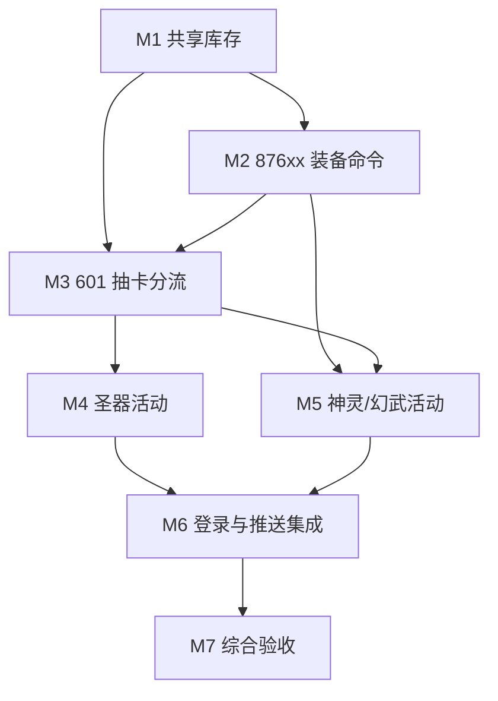

# 圣器天池与神灵降世：剩余工作拆分

更新时间：2026-10-31

## 基线

- worktree：`F:\projects\FateCovenantClone\.worktree\relic-divine-activities`
- 分支：`feature/relic-divine-activities`
- 基线 HEAD：`45c0b21`
- 启动时已有未提交文件：`config/game-tables.mjs`、`game/gateway.mjs`、`game/fantasy-draw-service.mjs`、`game/fantasy-equipment-inventory.mjs`、`game/fantasy-equipment-service.mjs`、`test/fantasy-draw-service.test.mjs`
- 最近完整基线：`233/233` 项测试通过；阶段一专项 `3/3` 通过
- 当前总体完成度估计：约 `12%`。业务命令只把 `87617–87618` 计为完成，`87601–87616` 已有初版但没有完成规则审计和专项测试；真实 TCP 与 APK/UI 尚未验收

这个百分比用于安排工作，不作为发布结论。完成度必须按以下四层分别记录，不能互相替代：

1. 服务端业务与 PB 回包
2. 自动化测试与 SQLite 事务
3. 真实 TCP 请求/响应
4. 隔离客户端 `com.jzyx.ps` 的 APK/UI 验收

只有四层全部通过，并且剩余假设和遗留项为零，才能写“圣器天池和神灵降世可玩验收完成”。

## 计划文件

| 顺序 | 文件 | 范围 | 主要产出 |
|---|---|---|---|
| M1 | [01-shared-inventory.md](01-shared-inventory.md) | 模块 518 共享幻武库存 | 原子库存 API、配置索引、异常回滚、持久化测试 |
| M2 | [02-fantasy-equipment.md](02-fantasy-equipment.md) | `87601`、`87603–87611`、`87613–87618` | 完整装备管理、编队、心愿、购买 |
| M3 | [03-draw-routing.md](03-draw-routing.md) | 标准 `601` 三池分流 | 服务端抽卡引擎、概率/保底/轮次/奖励/库存 |
| M4 | [04-artifact-act.md](04-artifact-act.md) | `101801–101806` | 圣器活动任务、试炼、翻牌、轮次、合成 |
| M5 | [05-demigod-fantasy-act.md](05-demigod-fantasy-act.md) | `98301–98308`、`88922/88924/88927–88932` | 两套活动的共享试炼、弹珠、心愿、复制、任务 |
| M6 | [06-login-push-integration.md](06-login-push-integration.md) | 登录容器与推送 | 三类活动入场状态、网关解码、`7001/9160/10101` |
| M7 | [07-verification-release.md](07-verification-release.md) | 整体验收 | 专项/全量/TCP/APK/UI、文档和遗留项审计 |

可直接交给新根 agent 的提示词在 [orchestrator-prompt.md](orchestrator-prompt.md)。

## 依赖图

推荐波次：

- 波次 A：只做 M1。它定义所有创建、删除、成长、奖励入库和事务接口。
- 波次 B：M2 与 M3 可并行，但二者不得同时修改 `gateway.mjs`；网关集成留给 M6。
- 波次 C：M4 与 M5 可并行；若 M3 尚未稳定，先完成不依赖抽卡结果的活动状态 API。
- 波次 D：M6 串行执行，保证只有一个 agent 修改网关、登录 payload 和容器注册。
- 波次 E：M7 串行执行，先自动化和 TCP，再单独做隔离 APK/UI。

## 不可破坏的共享约束

- 所有写操作都通过 `createGameStore().transaction()`。资源扣除、资源发放、模块状态、英雄/编队状态和库存变化必须同事务提交。
- 模块 `518` 当前块顺序是：
  - 第 0 块：`pb_fantasy_equip_res`
  - 第 1 块：`pb_fantasy_formation_list`
  - 第 2 块：`pb_fantasy_draw`
  新代码不得压缩、重排或用新列表整体替换已有块。
- 所有业务数量、奖励、概率、消耗、目标装备、阵营和活动版本由服务端查表决定。客户端 PB 只用于表达意图。
- ETF 和 PB 请求按协议目录或实际 Proto 解包。不得把嵌套消息、重复字段或二进制状态擅自降成单个整数。
- 每个命令必须验证：空/非法 ID、错误 tid/uid、重复 ID、越界数量、资源不足、活动未开放、错误活动版本、权限和上限。
- 重复请求要么幂等返回同一结果，要么稳定拒绝且不重复扣费；不能由客户端 `request_id` 之外的内存状态维持正确性。
- 活动每日刷新、终身累计、保底进度、心愿和任务领取必须落 SQLite。内存缓存只能加速，不能作为唯一状态。
- 不得信任客户端提交的 `cost_list`、奖励、概率、抽数或 `over_value`；可以要求它与服务端计算结果一致，然后忽略客户端数值。
- 修改 `gateway.mjs` 前由总控 agent 登记独占期。其他模块先暴露 `supports()`/`execute()`，集成 agent 再统一接线路由。
- 不 reset、checkout、stash、清理或覆盖现有未提交改动。不得 push、merge、操作原版包 `com.jzyx.my`。
- APK 操作只允许隔离包 `com.jzyx.ps`，ADB 固定为 `E:\Mumu\MuMuPlayer\nx_main\adb.exe -s 127.0.0.1:16448`。用户正在游玩时，不擅自停应用、点击界面或改路由。

## 每个模块的交付格式

子 agent 完成后必须返回：

- 修改文件列表和关键函数/PB 契约
- 实现与未实现命令的精确清单
- 使用的静态证据路径和表/字段
- 专项测试命令、通过数和失败数
- 新增的持久化与回滚覆盖
- 明确记录的未验证假设
- 是否存在与其他模块的未合并依赖

总控 agent 只有在亲自复核 diff、重跑该模块测试并确认没有把组件测试描述成真实 TCP/APK 验收后，才可更新本文件的完成度。
